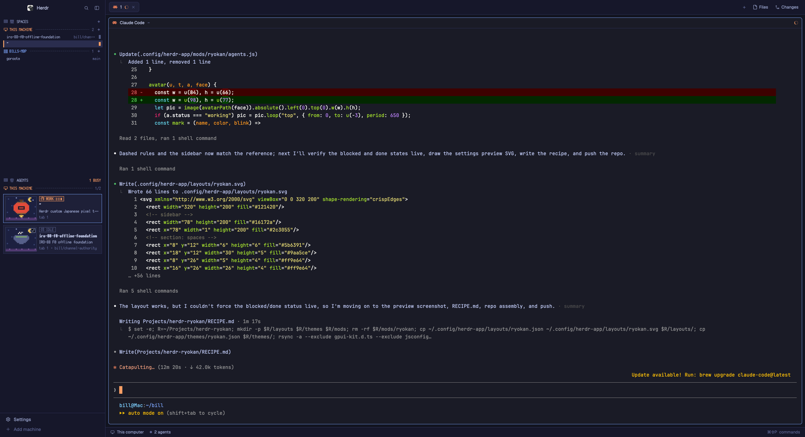

# Ryokan 旅館 — a pixel-art sidebar layout for Herdr

Herdr's main window with the sidebar redrawn in a Japanese pixel style:
spaces as rooms grouped by machine, agents as guest cards with pixel avatars
(maneki-neko, daruma, koi, kitsune mask, chōchin lantern, Fuji, torii, kappa,
sakura, matcha, tanuki, onigiri) in a starry night scene, set in the free
PixelMplus12 bitmap font over a Tokyo Night palette.



## Add it to your Herdr

Ask your agent, in Herdr:

> Add the layout at https://github.com/BilliamBrown/herdr-ryokan

or by hand, from `~/.config/herdr-app`:

```sh
cp layouts/ryokan.json layouts/ryokan.svg ~/.config/herdr-app/layouts/
cp themes/ryokan.json ~/.config/herdr-app/themes/
cp -R mods/ryokan ~/.config/herdr-app/mods/
herdr-app check ~/.config/herdr-app/mods/ryokan
herdr-app do layout.switch '{"name":"ryokan"}'   # or ctrl/cmd-shift-l
```

The fonts in `mods/ryokan/fonts/` load on the layout switch (or the next
start). Nothing here runs programs, reaches the network, or reads files
outside its folder.

[RECIPE.md](RECIPE.md) is the brief an agent can rebuild this from in an
empty folder: what you see, how it behaves, what it's built from.

## Credits

- [PixelMplus](https://github.com/itouhiro/PixelMplus) by itouhiro, M+ FONT
  LICENSE (free for any use), in `mods/ryokan/fonts/`.
- Colors after [Tokyo Night](https://github.com/enkia/tokyo-night-vscode-theme).
- Sprites and icons are original pixel art, generated from ASCII rows by
  `mods/ryokan/art/sprites.py`.

Code and art: MIT, see [LICENSE](LICENSE).
