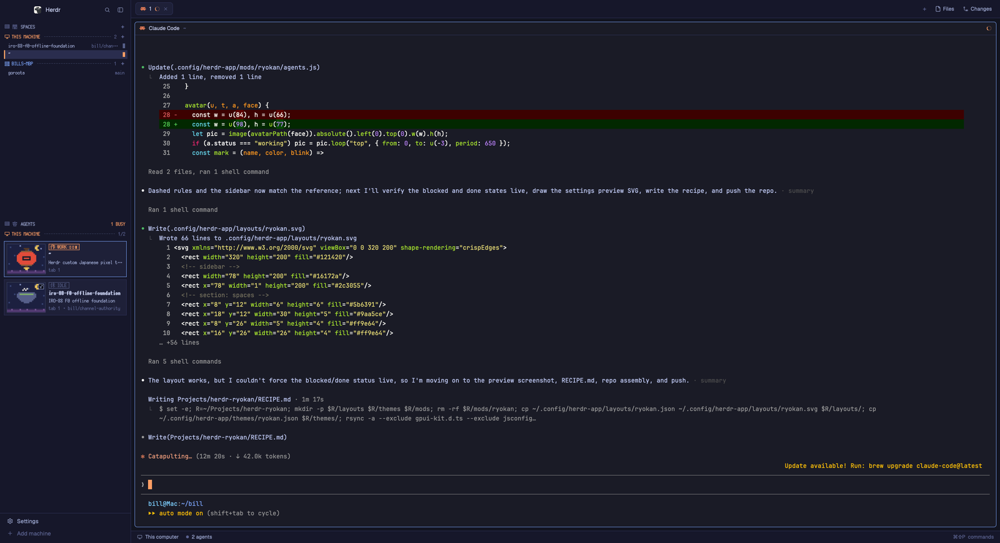

# Ryokan

Herdr's main window with a pixel-art sidebar: spaces as rooms grouped by machine, and every agent as a guest card with a Japanese pixel avatar (a beckoning cat, a daruma, a koi, a fox mask, a paper lantern, Mt. Fuji...) standing in a night scene. The sidebar is set in PixelMplus12, a free Famicom-style Japanese bitmap font, and the rest of the window (tabs, pane headers, Files and Changes, the status bar) is Herdr's own, recolored by a Tokyo Night palette with persimmon-orange highlights for working agents.



## What you see

Left to right, a dark indigo window (`#121420` canvas) with no system title bar; macOS traffic lights sit at (12, 16).

**Sidebar**, 300 px wide, `#16172a`, one 1 px `#2c3055` divider to its right:

- **Brand**, 46 px: Herdr's shipped `workspace-chrome` (logo, search, sidebar toggle). Not pixel.
- **間 SPACES** section (2 shares of the sidebar height, min 90 px). A 26 px header row in the pixel font: a 12 px shoji-screen icon in dim `#5b6391`, the kanji 間, "SPACES" in `#9aa5ce`, and a 16 px "+" pixel button at the far right. Under it, one group per machine: a 24 px machine row with a monitor icon (this computer) or stacked-server icon (a remote), the machine's name in capitals (THIS MACHINE for the local one), a 2 px dashed rule in `#3b4261` filling the middle, the number of spaces, and a "+" that starts a space on that machine. Local is orange (`#ff9e64`); remotes are blue (`#7aa2f7`). Each space is a 22 px row indented 10 px: a 3 px bar on the left (orange on the shown space, invisible otherwise), the name in `#c8d0f0` when shown / `#9aa5ce` otherwise, the git branch in dim on the right for unnamed spaces, and a 6×12 px lantern block in the status color when the space has agents. The shown space's row has a `#2a2d4e` background.
- **客 AGENTS** section (3 shares, min 90 px). Same header style with the kanji 客 and "AGENTS"; the right side says "N BUSY" (orange when N > 0, dim otherwise) and, before it, "N NEEDS YOU" in red when any agent is blocked. Then one machine row per machine that has agents, its right side "busy/total" (busy = working or blocked). Each agent is a **card**: 10 px side margins, 6 px padding, `#1e2038` fill, 1 px frame, 6 px between cards. The card holds:
  - a **98×77 px avatar**: one of twelve 28×22-cell pixel scenes (night sky `#1c2040`, ten stars, a gold crescent moon, a dusk-purple ground or, for the koi and the kappa, water) with a 16×16 sprite standing on the ground, in a 1 px `#3b4261` frame;
  - a **status box** in the status color, 16 px tall with a 1 px border: kanji, word, and for working agents an animated three-block meter, e.g. `作 WORK ▮▮▯`, `要 NEEDS YOU`, `済 DONE`, `休 IDLE`; a working box is filled with the color at 12% alpha; a pinned agent gets 留 after the box;
  - the **space's name** in bold 13 px `#c8d0f0`;
  - the **agent's title** (its terminal title, else the program name) in `#9aa5ce`, truncated;
  - "tab N" and "· branch" in dim.
- **Footer**, 69 px: Herdr's `workspace-chrome` footer (Settings, Add machine).

**Work area**: Herdr's shipped `tabs` bar (42 px), the tab's panes as cards (8 px padding and gap, radius 6, `#1a1b26` fill, 1 px `#3b4261` border, `#7aa2f7` when focused, 30 px `pane` header on top, framed even when alone), the hidden Files/Changes panel stack on the right (368 px, opened from the tab bar), and Herdr's `workspace-status` bar (28 px).

Terminals use the person's own font and size (the layout sets none) with Tokyo Night colors: background `#1a1b26`, text `#c0caf5`, orange `#ff9e64` cursor, selection `#33467c`.

## How it behaves

Statuses and their colors: working `#ff9e64`, blocked `#f7768e`, done `#9ece6a`, idle `#565f89`.

- **Working**: the card frame is orange; the avatar bobs up 3 px and back every 650 ms; the status box reads `作 WORK` plus a meter cycling `▮▯▯ ▮▮▯ ▮▮▮ ▯▮▮ ▯▯▮ ▯▯▯` every 220 ms; the space's lantern block pulses between 35% and 100% opacity every 1.1 s.
- **Blocked** (needs the person): red frame; a 14 px box in the avatar's top-right corner with a red "!" blinking between 20% and 100% every 500 ms; status box `要 NEEDS YOU`; the space's lantern block blinks red at the same rate; the AGENTS header shows "N NEEDS YOU" in red.
- **Done**: `#2c3055` frame; a green check in the avatar corner; status box `済 DONE`; green lantern block.
- **Idle**: `#2c3055` frame; a grey "z" in the avatar corner; status box `休 IDLE`.
- The **focused** agent's card frame is blue `#7aa2f7`, whatever its status.
- Cards are ordered within a machine: pinned first, then blocked, working, done, idle, newest change first. `agent.next` / `agent.prev` follow that order (the mod calls `setAgentOrder`).
- **Avatars**: an agent keeps the same face as long as its terminal lives. The face is picked from a hash of the terminal address; when two agents on screen would get the same face the later one (by address) takes the next free one, so up to twelve agents all differ.
- **Click a card**: focuses its pane (`pane.focus {pane}`); a sub-agent without a pane is peeked (`terminal.peek`). **Right-click**: Herdr's pane menu (split, zoom, send back, close). **Hover**: the card lightens to `#262a48`.
- **Click a space**: shows it. **Right-click**: Herdr's space menu (rename, worktrees, close). The machine row's "+" runs `space.new {machine}` (`""` for this computer); the section's "+" runs `space.new` with no machine.
- Nothing in the sidebar is pixel-perfect at zoom 1 only: every size is divided by the app zoom, so the font always lands on 12 logical px (24 device px on Retina) and stays crisp as the person zooms.
- Everything else is Herdr's: tabs, the + menu, pane headers, Files and Changes, the status bar, keys, dialogs.

## Built from

Four files plus one mod folder, laid out like the Herdr home:

```
layouts/ryokan.json   the window (a copy of Herdr's main with the two sidebar lists swapped)
layouts/ryokan.svg    the settings-screen preview (pixel-style miniature)
themes/ryokan.json    Tokyo Night colors; named like the layout so Settings offers it only here
mods/ryokan/          the sidebar mod: main.js, kit.js, spaces.js, agents.js, avatars.js, mod.json
mods/ryokan/fonts/    PixelMplus12 (Regular, Bold) and PixelMplus10, M+ FONT LICENSE
mods/ryokan/img/      avatar-<name>.svg, twelve 28×22 pixel scenes
mods/ryokan/icons/    shoji, monitor, server, plus, lantern, guest, zzz, bang, check: 12×12 one-color SVGs
mods/ryokan/art/sprites.py   the generator that wrote img/ and icons/ (ASCII rows → <rect>s)
```

**Layout tree** (`layouts/ryokan.json`): root `row`, `"titlebar": "none"`, `"traffic_lights": [12, 16]`, `"theme": "ryokan"`, `"background": "canvas"`, `"terminal_padding": [14, 12]`, `"preview": "layouts/ryokan.svg"`, divider 1 px `border`.
- `sidebar` column, `px: 300`, min 44, max 480, `background: chrome`, not resizable → `brand` block (46 px, `window_drag`, mod `workspace-chrome`) · `sidebar-lists` column → `spaces` block (weight 2, min 90, `{ "mod": "ryokan", "props": { "role": "spaces" } }`) and `agents` block (weight 3, min 90, `{ "mod": "ryokan", "props": { "role": "agents" } }`) · `sidebar-footer` block (69 px, `workspace-chrome` with `{ "footer": true }`).
- `work` column, not resizable → `tabs` block (42 px, `window_drag`, mod `tabs`) · `work-body` row (padding 8, gap 8) → `main` block (`{ "tab": "active", "pane": { gap 8, radius 6, background "background", lone true, border 1 "#3b4261", focus 1 "accent", header { mod "pane", height 30, top, always } } }`) and `panel` column (hidden, 368 px, min 280, max 900) → `panel-body` stack (active `files`) → `files` block and `changes` block · `status` block (28 px, mod `workspace-status`).

The ids `sidebar`, `panel`, `panel-body`, `files`, `changes` must stay: Herdr's `tabs` mod toggles the panel by those ids and `ctrl-shift-b` / `cmd-b` toggles `sidebar`.

**Theme** (`themes/ryokan.json`): `background #1a1b26`, `foreground #c0caf5`, `selection #33467c`, `cursor #ff9e64`, ansi `#15161e #f7768e #9ece6a #e0af68 #7aa2f7 #bb9af7 #7dcfff #a9b1d6 #414868 #ff899d #b9f27c #ffc777 #8db0ff #c7a9ff #9fe7ff #c0caf5`; `colors`: canvas `#121420`, chrome `#16172a`, surface `#1a1b2e`, popover `#1f2037`, raised `#1e2038`, hover `#262a48`, selected `#2a2d4e`, border `#2c3055`, input `#3b4261`, foreground `#c8d0f0`, muted `#9aa5ce`, dim `#5b6391`, accent `#7aa2f7`, accent_foreground `#121420`, solid `#ff9e64`, solid_foreground `#121420`, working `#ff9e64`, blocked `#f7768e`, done `#9ece6a`, idle and unknown `#565f89`.

**The mod** (`mods/ryokan/`, `mod.json` = `{ "place": "none", "title": "Ryokan" }`):
- `main.js`: default-exports a `View`; `init` reads `props().role` and instantiates `Spaces` or `Agents`; `render` delegates. Unknown role: a one-line message.
- `kit.js`: `FONT = "PixelMplus12"`, `unit()` → `u(n) = n / settings().zoom`; `root(u, el)` sets `font_family(FONT)`, `text_size(u(12))`, `line_height(u(14))`, `theme().foreground`; `icon(name, size, color?)` = `svg("mods/ryokan/icons/<name>.svg")`, tinted only when a color is given; `STATUS` table (word, kanji, theme color name); `statusColor`; `sectionHeader(u, t, kanji, label, right)`; `machineHeader(u, t, id, name, right, color)` with the dashed rule (`div().flex_1().h(2).border_t(2).border_dashed().border_color(t.input)`); `pixelBox(u, color, children, {bg, id})`; `iconButton(u, t, id, icon, onClick, tooltip)` (stops mouse-down propagation so it works inside `window_drag` blocks); `contextMenu(tab, target)` = `openOverlay({ mod: "menu", kind: "popup", width: 200, height: 260, props: { tab, target } })`.
- `avatars.js`: `AVATARS` = neko, daruma, koi, onigiri, kitsune, chochin, fuji, torii, kappa, sakura, matcha, tanuki; FNV-1a `hash(address) % 12`, then the next free name; `avatarPath(name)` = `mods/ryokan/img/avatar-<name>.svg`.
- `spaces.js`: groups `spaces()` by `machines()` order (local `null` first), appending any machine `machines()` doesn't list; count shows `…` while a machine's layout is loading and `offline` when unavailable. Uses `run("space.select")`, `run("space.new", { machine })`, `theme()`.
- `agents.js`: `agents()` grouped by their space's `machine` (via `spaces()`), sorted as above; `panes()` decides click → `pane.focus` or `terminal.peek`; `setAgentOrder` each render. Working meter: `div().frames([...6 strings], 220)`; bob: `image(...).absolute().loop("top", { from: 0, to: u(-3), period: 650 })`; blink: `.loop("opacity", { from: 0.2, to: 1, period: 500 })`.
- `art/sprites.py` (Python 3, no dependencies): sprite rows → `<rect>` SVGs with `shape-rendering="crispEdges"`; icons use `fill="currentColor"` so `svg()` tints them. Rerun it after editing a sprite: `python3 mods/ryokan/art/sprites.py`.

No programs run, no network, no files read outside the mod. Shipped mods used as-is: `workspace-chrome`, `tabs`, `pane`, `files`, `changes`, `workspace-status`, `menu`, `new-menu` (through `tabs`).

## Watch out

- **Fonts load at app start** (and on the next look change). After copying `mods/ryokan/fonts/`, switch layouts or restart Herdr, or the sidebar falls back to the UI font. The family names inside the TTFs are exactly `PixelMplus12` and `PixelMplus10`.
- **`text_color(undefined)` throws** ("expected a string, got nil") and takes the whole view down. Tint icons only when a color is given.
- **`border_dashed()` needs a whole-pixel width.** A dashed `border_t(u(1))` (0.9 px at zoom 1.1) drew nothing; `border_t(2)` draws.
- **Sizes are design px ÷ zoom.** Don't hardcode 12 px text: at zoom 1.1 it renders at 13.2 px and the bitmap font looks smeared. The terminal font is left to the person's settings on purpose.
- **Agent status words are only from the program's OSC 7501 report.** A plain shell shows no card; the card appears once the agent reports. A test shell that prints a guessed sequence doesn't register.
- **A space on a remote machine whose core is offline** lists under that machine with `offline`; its agents don't appear until the core answers.
- `herdr-app check` doesn't lay out `frames`/`loop` motion; verify them in the app with `herdr-app shot`.
- Ids `sidebar`, `panel`, `panel-body`, `files`, `changes` are load-bearing for Herdr's `tabs` mod and `cmd-b`.
- The reference screenshot this was built from showed a "Usage" button in the tab bar; Ryokan doesn't add one (the tab bar is Herdr's).
- Limits: twelve distinct avatars; the thirteenth agent repeats a face. Card text truncates at the card's width (space name, title, tab line each one line).

## Done when

- `herdr-app check ~/.config/herdr-app/mods/ryokan` passes.
- `herdr-app do layout.switch '{"name":"ryokan"}'` then `herdr-app status` shows `"layout": "ryokan"` and `"errors": []`.
- `herdr-app shot` shows: the sidebar text in a bitmap pixel font; a 間 SPACES header with a "+"; an orange THIS MACHINE row with a dashed rule and a count; the shown space with an orange left bar and `#2a2d4e` background.
- With a Claude Code (or any reporting agent) running: a card with a pixel avatar in a starry night scene, an orange frame, a `作 WORK` box whose meter changes between two shots a second apart, and the space's orange lantern block.
- With an idle agent: a grey frame, a "z" box in the avatar's corner, `休 IDLE`.
- When that agent asks a permission question: the frame and box turn red, the corner shows "!", the AGENTS header says "1 NEEDS YOU".
- Clicking a card focuses that pane (the pane's border turns `#7aa2f7`, the card's frame too). Right-clicking a card opens Split right / Split down / Zoom / Close pane. Right-clicking a space opens Rename / Close.
- `cmd-]` moves between agents in the cards' order.
- `cmd-shift-l` cycles back to `main` and the window looks as before; the layout's own theme leaves `main` untouched.
